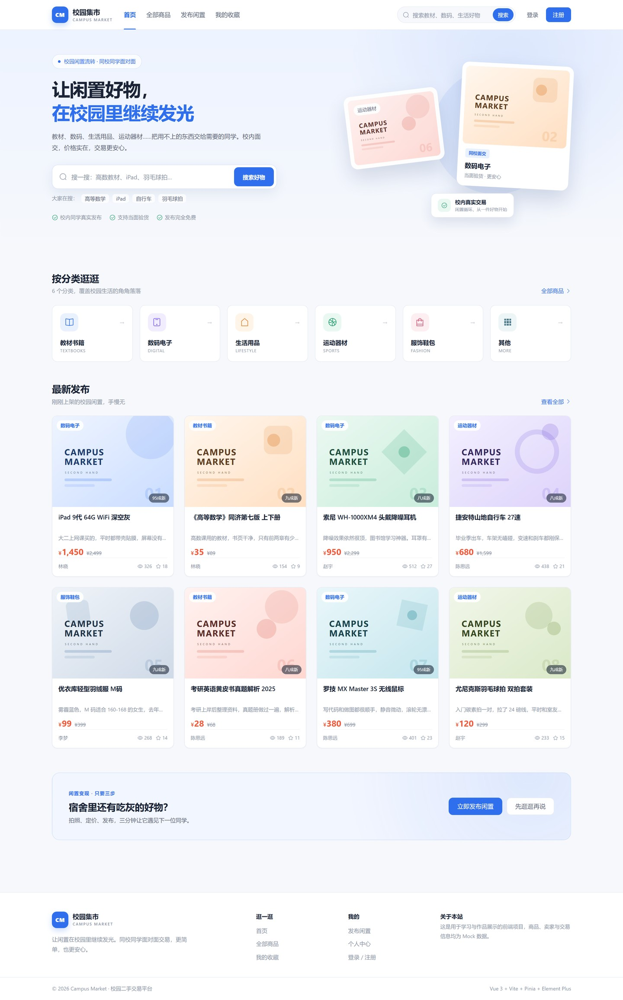
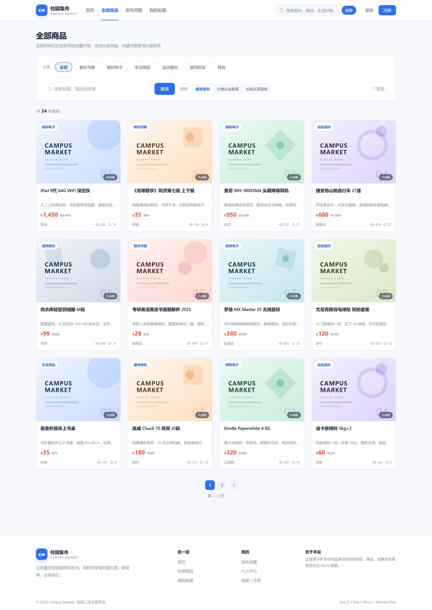
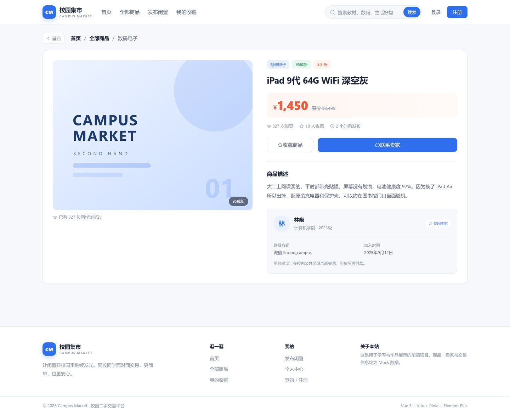
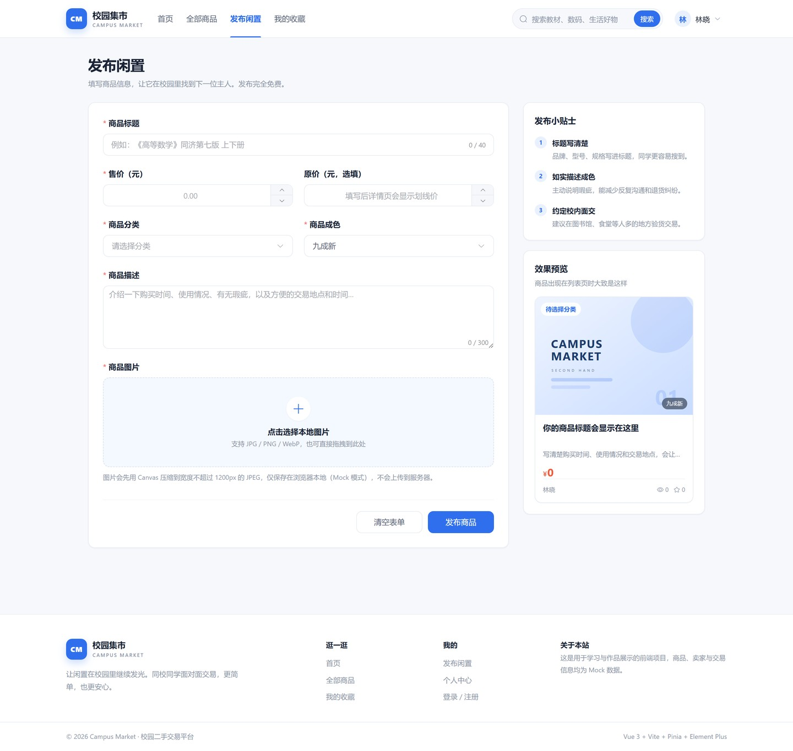
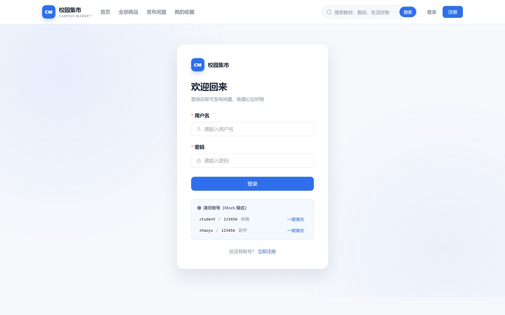
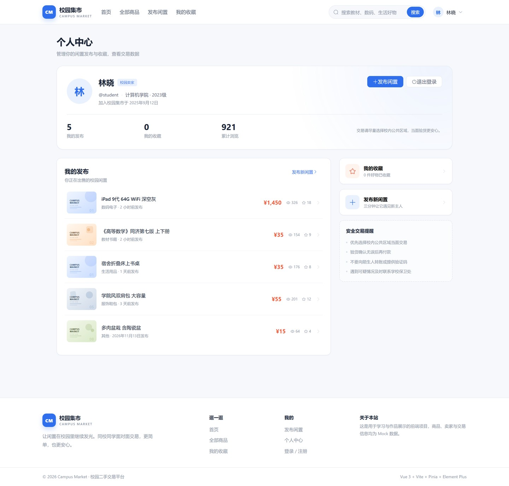

# 校园集市 Campus Market

一个面向校内学生的二手闲置交易平台前端项目。教材、数码、生活用品、运动器材、服饰鞋包……同学们可以把用不上的东西发布出来，在校内完成当面交易。

项目使用 **Vue 3 + Vite + Pinia + Vue Router + Element Plus + Axios** 构建，内置完整的 Mock 数据层，**克隆下来 `npm install && npm run dev` 就能看到完整数据和交互，无需后端、无需联网加载图片**。

---

## 功能清单

| 页面 | 路由 | 功能 |
| --- | --- | --- |
| 首页 | `/` | 顶部 Banner、关键词搜索、6 个分类宫格、最新 8 条商品、发布引导 |
| 商品列表 | `/list` | 分类筛选、关键词搜索、三种排序、分页、加载骨架屏、keep-alive 状态缓存 |
| 商品详情 | `/detail/:id` | 大图、标题、现价 / 划线原价、分类与成色标签、描述、卖家信息、收藏、浏览量 |
| 发布商品 | `/publish` | 标题 / 价格 / 原价 / 分类 / 成色 / 描述 / 图片表单，必填校验，Canvas 压缩预览 |
| 个人中心 | `/profile` | 用户信息卡、发布 / 收藏 / 浏览统计、我的发布列表、我的收藏入口、退出登录 |
| 登录 | `/login` | 居中卡片登录、演示账号一键填充、登录后跳回原页面 |
| 注册 | `/register` | 用户名 / 昵称 / 学院 / 密码校验，注册成功后自动登录 |
| 我的收藏 | `/favorites` | 收藏商品网格、取消收藏、空状态引导 |

其他细节：

- 顶部导航 sticky，包含全局搜索入口与登录状态菜单。
- `/publish`、`/profile`、`/favorites` 受路由守卫保护，未登录跳转 `/login?redirect=...`。
- 商品卡片 hover 上浮，商品网格响应式：`>1200px` 4 列、`>=768px` 3 列、`<768px` 2 列。
- 全站中文界面、中文注释，主色 `#2F6FED`，设计变量集中在 `src/styles/main.css`。

---

## 技术栈

| 技术 | 版本 | 用途 |
| --- | --- | --- |
| Vue | 3.4 | 组合式 API / `<script setup>` |
| Vite | 5 | 开发服务器与构建 |
| Vue Router | 4 | 路由、懒加载、登录守卫、重定向 |
| Pinia | 2 | 用户状态、列表筛选状态 |
| Element Plus | 2 | 表单、弹窗、分页、消息提示等基础组件 |
| Axios | 1 | 请求实例、token 注入、统一错误处理 |
| 原生 JavaScript | ES2020+ | 未使用 TypeScript |

---

## 演示账号

Mock 模式内置 2 个演示账号，登录页可一键填充：

| 用户名 | 密码 | 昵称 | 学院 |
| --- | --- | --- | --- |
| `student` | `123456` | 林晓 | 计算机学院 · 2023级 |
| `zhaoyu` | `123456` | 赵宇 | 机械工程学院 · 2022级 |

也可以直接在注册页创建新账号，注册信息保存在浏览器 localStorage 中。

---

## 快速开始

环境要求：Node.js >= 18，npm >= 9。

```bash
# 安装依赖
npm install

# 启动开发服务器（默认 http://localhost:5173）
npm run dev

# 生产构建，产物输出到 dist/
npm run build

# 本地预览构建产物
npm run preview
```

项目默认使用 Mock 数据，不需要启动任何后端服务。

---

## 目录结构

```text
campus-market/
├── public/
│   ├── covers/                 # 8 张本地渐变 SVG 商品封面（离线可用）
│   │   ├── 1.svg
│   │   ├── 2.svg
│   │   ├── 3.svg
│   │   ├── 4.svg
│   │   ├── 5.svg
│   │   ├── 6.svg
│   │   ├── 7.svg
│   │   └── 8.svg
│   └── favicon.svg
├── src/
│   ├── api/
│   │   ├── product.js          # 商品 / 收藏接口封装
│   │   ├── request.js          # axios 实例、拦截器、Mock 错误处理
│   │   └── user.js             # 登录 / 注册接口封装
│   ├── components/
│   │   ├── AppHeader.vue       # 顶部导航 + 全局搜索 + 登录状态
│   │   ├── EmptyState.vue      # 通用空状态
│   │   ├── ImageUploader.vue   # 本地选择图片 + Canvas 压缩 + 预览
│   │   ├── PageTitle.vue       # 页面标题
│   │   ├── ProductCard.vue     # 商品卡片
│   │   └── SkeletonCard.vue    # 商品骨架屏
│   ├── constants/
│   │   └── product.js          # 分类、成色固定枚举
│   ├── mock/
│   │   ├── data.js             # 24 条商品种子数据 + 演示账号
│   │   ├── index.js            # Mock 接口实现（延迟 / 分页 / 筛选 / 排序 / 收藏）
│   │   └── README.md           # Mock 说明与真实后端切换方式
│   ├── router/
│   │   └── index.js            # 8 个页面路由 + 登录守卫
│   ├── stores/
│   │   ├── filter.js           # 列表筛选条件收敛
│   │   └── user.js             # token / userInfo
│   ├── styles/
│   │   └── main.css            # CSS 变量、全局样式、Element Plus 主题
│   ├── utils/
│   │   ├── format.js           # 价格 / 相对时间 / 折扣格式化
│   │   ├── navigation.js       # 登录重定向地址校验
│   │   └── storage.js          # localStorage 键名与安全读写
│   ├── views/
│   │   ├── HomeView.vue
│   │   ├── ListView.vue
│   │   ├── DetailView.vue
│   │   ├── PublishView.vue
│   │   ├── ProfileView.vue
│   │   ├── LoginView.vue
│   │   ├── RegisterView.vue
│   │   └── FavoritesView.vue
│   ├── App.vue
│   └── main.js
├── .env.example
├── .gitignore
├── index.html
├── jsconfig.json
├── LICENSE
├── package-lock.json
├── package.json
├── README.md
└── vite.config.js
```

---

## 实现要点

### 1. Mock 方案：默认离线可跑

- `src/api/*.js` 中统一判断 `import.meta.env.VITE_USE_MOCK !== 'false'`，默认走 `src/mock/` 适配层，只有显式设置为 `false` 才走真实 `axios`。
- Mock 层模拟 **300ms 网络延迟**，并实现分页、分类筛选、关键词搜索（标题 / 描述 / 卖家）、三种排序、收藏、发布、登录注册。
- 商品封面全部使用 `public/covers/1.svg ~ 8.svg`，不依赖远程图片或 CDN。
- 用户发布的商品、注册账号、收藏记录会写入 localStorage，刷新页面不丢失。
- 真实后端切换方式和接口约定见 [`src/mock/README.md`](src/mock/README.md)。

### 2. 路由守卫与登录回跳

- 需要登录的路由在 `meta.requiresAuth` 中标记，全局 `beforeEach` 拦截：
  - 未登录 → `/login?redirect=<原路径>`；
  - 登录成功后读取 `redirect`，校验为站内路径后 `router.replace` 回去；
  - 已登录用户访问登录 / 注册页会直接回到首页。
- `sanitizeRedirect` 只允许 `/` 开头的站内路径，避免开放重定向。

### 3. keep-alive 缓存列表状态

- `App.vue` 中使用 `<keep-alive :include="['ListView']">` 包裹路由出口，`ListView` 通过 `defineOptions({ name: 'ListView' })` 声明组件名。
- 分类、关键词、排序、页码都存放在 Pinia 中，返回列表页时筛选条件与所在页保持不变。
- 列表页 `onActivated` 时做一次静默刷新，同步收藏数、浏览量等可能变化的数据，不会重新出现骨架屏。

### 4. Canvas 图片压缩

- `ImageUploader.vue` 读取本地图片后按最大宽度 `1200px` 等比缩放，绘制到 Canvas 并导出 JPEG（质量 `0.8`）。
- 透明 PNG 会先铺白色背景，避免转 JPEG 后变黑。
- 压缩结果通过 `v-model` 回传给发布表单，仅用于本地预览和 Mock 存储，不会上传服务器。

### 5. Pinia 收敛筛选条件

- `stores/filter.js` 用一个 `query` 对象承载 `category / keyword / sort / page / pageSize`。
- `setFilter(patch)` 合并条件，除翻页外的任何筛选变化都会自动回到第 1 页；`resetFilter()` 恢复默认值。
- 首页分类入口、顶部全局搜索、列表页筛选与分页都只操作这一个 store，避免各页面各拼一套参数导致状态不同步。

### 6. 请求与错误处理

- `request.js` 创建 axios 实例，`baseURL` 取 `import.meta.env.VITE_API_BASE || '/api'`。
- 请求拦截自动注入 `Authorization: Bearer <token>`。
- 响应拦截兼容 `{ code, data, message }` 结构，非 0 码与 HTTP 错误统一 `ElMessage` 提示；401 会清理本地登录态。
- Mock 请求不经过 axios，通过 `mockRequest()` 补上同样的错误提示，保证两种模式体验一致。

---

## 项目截图

| 首页 | 全部商品 |
| :---: | :---: |
|  |  |
| **商品详情** | **发布闲置** |
|  |  |
| **登录** | **个人中心** |
|  |  |

> 以上为项目实际运行截图（1440×900 视口，2 倍图缩放）。演示账号：`student` / `123456`。

---

## 可继续优化的点

- **对接真实后端**：按 `src/mock/README.md` 的接口约定实现服务端，把收藏、发布等写操作改为服务端持久化。
- **收藏乐观更新**：当前取消收藏会等待接口返回，可改为先更新 UI、失败再回滚。
- **图片上传**：真实环境应上传到对象存储 / OSS，并由后端返回 URL，而不是存 DataURL。
- **商品管理**：补充编辑、下架、标记已售出、发布草稿等能力。
- **站内沟通**：增加留言或私信，不必直接暴露微信。
- **体验细节**：列表虚拟滚动、图片懒加载占位、骨架屏与真实卡片尺寸的精细对齐。
- **工程化**：增加 ESLint + Prettier、单元测试（Vitest）、E2E（Playwright）、提交规范与 CI。
- **可访问性**：补充键盘操作、焦点管理与更完整的 ARIA 标注。
- **国际化**：文案抽离，支持中英文切换。

---

## License

[MIT](./LICENSE)
